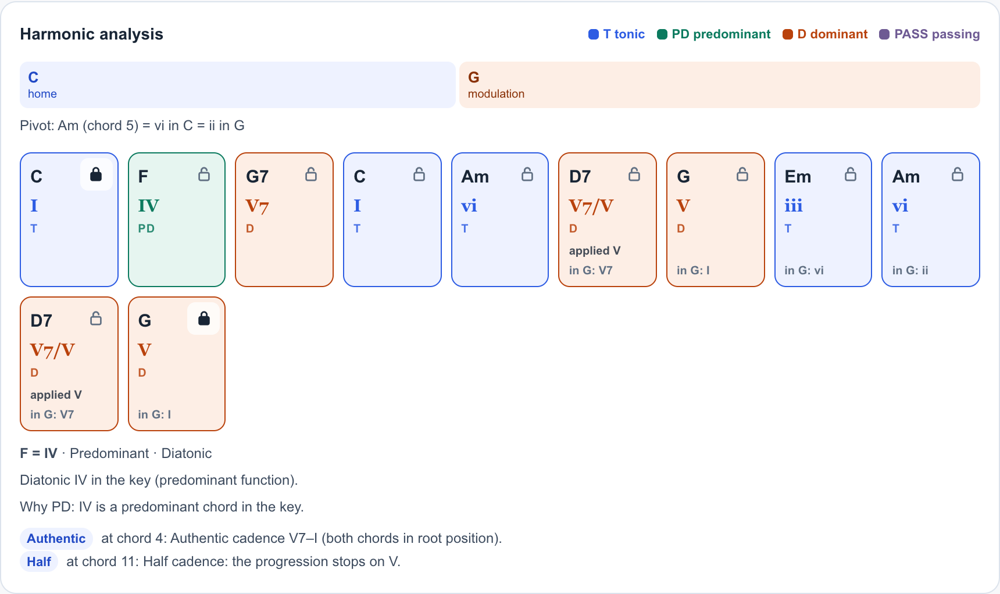

# Progression Lab

A browser-only chord-progression analyser: it finds the key, names each chord's function, plots harmonic tension, suggests reharmonisations with a reason for each change and picks playable guitar voicings. The engine is pure TypeScript with no runtime dependencies, no server and no model API.

Built with AI coding agents (Claude, Codex); tests and verification by me.



The engine's analysis as rendered by the portfolio site's UI: Roman numerals, functions, a modulation from C to G with its pivot chord, and cadences. Screenshot from an earlier build of the site. Interactive version: https://astro-young.com/work/progression-lab

## Results

| Check | Result | Source |
|---|---|---|
| Key detection on 52 hand-labelled progressions (9 deliberately hard) | 47 of 52 exact (90.4%); correct key in the top two for all 52; MIREX-weighted score 0.919; 3 of the 5 misses flagged as ambiguous by the tool | `src/corpus.ts`, `src/evaluation.ts`, printed by `src/__tests__/keyfinding.test.ts` |
| Advanced harmony on a second hand-labelled set | 44 of 44 progressions match every expectation (103 of 103 checks) | `src/advancedCorpus.ts`, printed by `src/__tests__/advanced.test.ts` |
| Song examples for the 35-entry library | 55 of 56 candidates confirmed by a web source, 1 dropped; 38 shown (at most two per progression) | `src/library.ts`, `docs/library_sources.md`, printed by `src/__tests__/library.test.ts` |
| Voicing path: dynamic programming against brute force | Equal cost on 52 of 52 small cases | printed by `src/__tests__/voicing.test.ts` |
| Reharmonisation properties, 260 target-curve and lock combinations | Locked chords never change, every suggestion parses back to the same notes, none is farther from the target curve than the original | `src/__tests__/reharm.test.ts` |
| Test suite | 201 tests pass | `src/__tests__/` |

The advanced-set score is not blind: while implementing, I made one general fix (key tracking starts in the home key) that also fixed one entry.

## How it was verified

- The key-finding labels were written by hand before the algorithm was run, and the Krumhansl–Kessler profile weights were fixed in advance, not tuned on this set. The nine hard cases (modal vamps, relative-key loops, blues dominants, power chords) stay in the headline figure.
- The advanced set's expected devices, functions, spans and key regions were written down and committed before the analyser was built. A progression counts as a match only if every expectation holds.
- Property tests transpose every labelled progression into all 12 keys and require identical key positions, Roman numerals, functions, devices, cadences and tension values.
- The voicing optimiser is checked against exhaustive search, and the reharmoniser is run on 260 combinations of target curve and locked chords.
- Library song examples were checked one by one against web sources (Wikipedia first, then lessons and analyses); every kept example stores its source.

## Limits

- Western tonal and jazz harmony only. The model does not read melody, lyrics or audio, so it cannot judge whether a chord fits the tune sung over it.
- Labels are rule-based. Where a chord has several valid readings, the tool picks one by fixed rules and lists the others. Functions marked as inferred are guesses from the root degree.
- The tension model is a simplified Tonal Pitch Space: no prolongational tree, heuristic weights for added-tone dissonance. Its curve is a guide, not a measurement of how listeners hear tension.
- Suggestions come from fixed substitution rules ranked by a score. A lower score is not a promise that a change sounds better.
- Both labelled sets were chosen and labelled by me, so their scores say little about real repertoire. Key confidence is a relative score, not a calibrated probability, and voicing difficulty is a hand-set heuristic.
- The React UI is part of the portfolio site and is not in this repository.

## Run it

Tested with Node.js 26.

```sh
git clone https://github.com/hyh4867/progression-lab.git
cd progression-lab
npm ci
npm test
npm run typecheck
```

The tests print the evaluation figures above (`[key-finding]`, `[advanced]`, `[library]`, `[voicing]` lines). No data download is needed. The design and algorithms are described in `docs/progression_lab.md` and `docs/tension_model.md`.

## Data, citation and licenses

- The two labelled sets are chord sequences I wrote and labelled. The library refers to songs by title and artist only, with no melodies or lyrics; the source for each example is stored in `src/library.ts` and listed in `docs/library_sources.md`.
- Krumhansl, *Cognitive Foundations of Musical Pitch* (1990), [doi:10.1093/acprof:oso/9780195148367.001.0001](https://doi.org/10.1093/acprof:oso/9780195148367.001.0001).
- Lerdahl, *Tonal Pitch Space* (2001), [doi:10.1093/acprof:oso/9780195178296.001.0001](https://doi.org/10.1093/acprof:oso/9780195178296.001.0001).
- Karplus & Strong, Digital Synthesis of Plucked-String and Drum Timbres, *Computer Music Journal* (1983), [doi:10.2307/3680062](https://doi.org/10.2307/3680062).
- Development dependencies: TypeScript (Apache-2.0) and Vitest (MIT). There are no runtime dependencies.
- Code: MIT License, see `LICENSE`.
